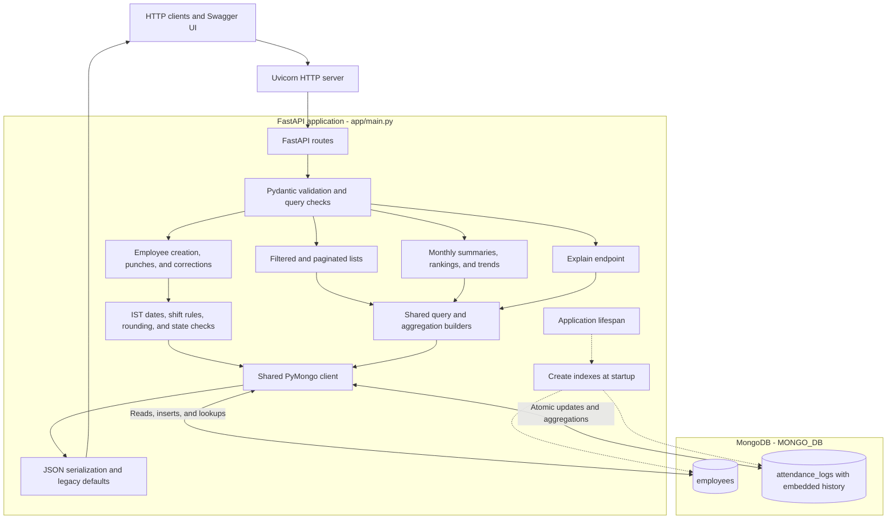

# Employee Attendance and Analytics API

A Python API for managing employee attendance and answering attendance questions with MongoDB aggregations. It supports punch-in and punch-out, manual corrections with an audit trail, monthly summaries, late rankings, and daily department trends.

**Stack:** Python 3.11+, FastAPI, Pydantic v2, synchronous PyMongo, and MongoDB 6.0+. Integration and scale checks were run against MongoDB 7.

## Architecture

The diagram shows the logical responsibilities inside `app/main.py`. The application uses one shared MongoDB client; all application code is in that file.



### How requests are handled

- **Writes:** validate the request, resolve the employee, apply attendance rules, and insert or conditionally update one record. Unique indexes prevent duplicate employees and duplicate employee/day records.
- **Corrections:** compute the final state and changed fields, then atomically combine `$set` with `$push`. The update checks the expected record values and history length, so a stale request receives `409` rather than overwriting another edit.
- **Analytics:** MongoDB performs joins, grouping, ranking, calendar generation, and window averages. Analytics read the stored derived values.
- **Explain:** reuse the real endpoint's query or pipeline and run MongoDB `explain` with `executionStats`.
- **Responses:** convert UTC BSON datetimes to integer epoch milliseconds, omit internal identifiers, and provide defaults for legacy fields.

Synchronous route handlers use FastAPI's thread pool for blocking PyMongo calls. Startup creates indexes idempotently, and shutdown closes the client. Startup does not seed, delete, or migrate existing records.

## Run locally

### Prerequisites

- Python 3.11 or newer available in your terminal.
- MongoDB 6.0 or newer; MongoDB 7 matches the version used for integration tests.
- Git. Docker Desktop or Docker Engine is optional for running MongoDB locally.

### 1 Get the code

```sh
git clone https://github.com/pjha26/hrone-attendance-api.git
cd hrone-attendance-api
```

If you already have a checkout, open a terminal at its root and continue below.

### 2 Start MongoDB

Use an existing local MongoDB server or an Atlas connection URI. To create a local MongoDB 7 container, first start Docker, then run:

```sh
docker run --name hrone-mongo -d -p 127.0.0.1:27017:27017 -v hrone-mongo-data:/data/db mongo:7.0
```

On subsequent runs, start that container with `docker start hrone-mongo`. The named volume retains local development data. No Dockerfile is required.

### 3 Install dependencies

Windows PowerShell:

```powershell
python -m venv .venv
.\.venv\Scripts\python.exe -m pip install -r requirements.txt
```

Linux or macOS:

```sh
python3 -m venv .venv
.venv/bin/python -m pip install -r requirements.txt
```

These commands invoke the virtual environment directly, so activation is optional. If `python` opens the Microsoft Store on Windows, install Python 3.11+ and ensure your chosen interpreter is available in the terminal.

### 4 Configure and launch

| Variable | Default | Purpose |
|---|---|---|
| `MONGO_URI` | `mongodb://localhost:27017` | MongoDB connection URI |
| `MONGO_DB` | `attendance_db` | Application database name |
| `TEST_MONGO_URI` | Unset | Connection used by integration tests |

Windows PowerShell:

```powershell
$env:MONGO_URI = "mongodb://127.0.0.1:27017"
$env:MONGO_DB = "attendance_db"
.\.venv\Scripts\python.exe -m uvicorn app.main:app --port 8000
```

Linux or macOS:

```sh
export MONGO_URI="mongodb://127.0.0.1:27017"
export MONGO_DB="attendance_db"
.venv/bin/python -m uvicorn app.main:app --port 8000
```

With the virtual environment activated, the equivalent startup command is `uvicorn app.main:app --port 8000`.

An optional local `.env` is loaded without overriding shell environment variables. Keep connection credentials and `.env` files out of Git.

Open [the health check](http://localhost:8000/health) and [Swagger UI](http://localhost:8000/docs). Health returns `{"status":"ok"}` when MongoDB responds; a connectivity failure returns `503`.

## API reference

| Method | Path | Purpose |
|---|---|---|
| GET | `/health` | Database readiness |
| POST | `/employees` | Create an employee |
| GET | `/employees` | Filtered, paginated employee list |
| POST | `/attendance/punch-in` | Create an attendance record |
| POST | `/attendance/punch-out` | Close the latest eligible record |
| GET | `/attendance` | Filtered, paginated attendance list |
| PATCH | `/attendance/{emp_code}/{date}` | Correct a record and append history |
| GET | `/analytics/employees/{emp_code}/monthly` | Employee summary; requires `month` |
| GET | `/analytics/departments/summary` | Department summaries; requires `month` |
| GET | `/analytics/leaderboard/late` | Late ranking; requires `month` |
| GET | `/analytics/departments/{department}/trend` | Daily trend; requires `from` and `to` |
| GET | `/admin/explain/{endpoint}` | Execution plan for the selected operation |

List pages start at `1`; `page_size` defaults to `20` and is capped at `100`. Department filters are exact and case-sensitive. Months use `YYYY-MM`; dates use `YYYY-MM-DD`.

### Try an attendance flow

Use **Try it out** in Swagger UI and submit these requests in order.

**POST `/employees`** returns `201`:

```json
{
  "emp_code": "EMP0001",
  "name": "Test Employee",
  "email": "test@example.com",
  "department": "Engineering",
  "shift_start": "09:30",
  "shift_end": "18:30",
  "joined_on": "2026-07-01"
}
```

**POST `/attendance/punch-in`** returns `201`:

```json
{
  "emp_code": "EMP0001",
  "punched_at": 1783312500000,
  "status": "PRESENT"
}
```

**POST `/attendance/punch-out`** returns `200`:

```json
{
  "emp_code": "EMP0001",
  "punched_at": 1783345200000
}
```

These punches represent 6 July 2026, 10:05 AM to 7:10 PM IST. The completed record has `late_minutes: 35`, `work_hours: 9.08`, `overtime_minutes: 40`, and `half_day: false`. Repeating employee creation or punch-in returns `409`.

Query `/analytics/employees/EMP0001/monthly?month=2026-07` for the employee summary. To inspect its query plan, use `/admin/explain/employee_monthly?emp_code=EMP0001&month=2026-07`.

## Data and attendance rules

| Collection | Identity | Contains |
|---|---|---|
| `employees` | Unique `emp_code` | Employee details, department, shift, join date, and creation instant |
| `attendance_logs` | Unique `(emp_code, date)` | Status, punches, stored derived values, and correction history |

`emp_code` is the business identifier. MongoDB `_id` stays internal. Instants are integer epoch milliseconds in the API and UTC BSON datetimes in storage. Dates and shift times are IST calendar values. Instants are truncated to whole seconds before attendance calculations.

- `PRESENT`, `WFH`, and `ON_DUTY` count as presence. `ABSENT` and `LEAVE` do not.
- Overnight shifts attribute a punch-in before shift end to the previous attendance day.
- Lateness starts strictly after the ten-minute grace period and counts whole minutes from shift start.
- Overtime counts only when the floored duration after shift end reaches thirty minutes.
- Work hours use two-decimal half-up rounding; a rounded duration below `4.50` is a half day.
- Derived fields are calculated by the server; client-supplied derived values are ignored.
- Only manual corrections append history. Punch-in and punch-out leave it unchanged.

Validation failures return `422`, missing resources `404`, and duplicate or stale writes `409`.

## Analytics and indexes

Employee monthly summaries count working days from the employee's join date and apply half-day weights to weekday presence. Weekend records still contribute to lateness and overtime.

Department summaries start with eligible employees, so people with no logs still contribute to headcount. Work-hour averages divide the sum of eligible record hours by their record count.

The late leaderboard uses `$rank` for competition ranking, such as `1, 2, 2, 4`. Filtering `rank <= limit` includes ties at the cutoff. Tied rows are ordered by employee code after ranking.

Department trends aggregate attendance by employee and date, generate the requested calendar in MongoDB, and use `$setWindowFields` for seven-day moving averages. Empty dates and weekends remain in the result; null rates are excluded from the average. Ranges include at most 92 calendar days.

Startup creates unique identity indexes and compound indexes for department/join-date queries, date ordering, status-filtered lists, and latest punch-in lookup. [DECISIONS.md](DECISIONS.md) explains the choices; [REVIEW.md](REVIEW.md) records the starter defects and fixes.

The explain endpoint supports `attendance_list`, `employee_monthly`, `department_summary`, `late_leaderboard`, and `department_trend`. It accepts the selected endpoint's parameters and returns `{endpoint, collection, explain}` with raw MongoDB `executionStats` output.

## Testing

Install development dependencies and run the full suite against a running MongoDB server.

Windows PowerShell:

```powershell
.\.venv\Scripts\python.exe -m pip install -r requirements-dev.txt
$env:TEST_MONGO_URI = "mongodb://127.0.0.1:27017"
.\.venv\Scripts\python.exe -m pytest -q
```

Linux or macOS:

```sh
.venv/bin/python -m pip install -r requirements-dev.txt
export TEST_MONGO_URI="mongodb://127.0.0.1:27017"
.venv/bin/python -m pytest -q
```

The current suite contains **46 tests**. Without `TEST_MONGO_URI`, integration tests are skipped. Integration tests create and drop a uniquely named `hrone_test_<uuid>` database, separate from `MONGO_DB`; the connection needs permission to create indexes and remove that test database.

Coverage includes strict input validation, time and rounding boundaries, overnight shifts, pagination, duplicate request races, overlapping corrections, audit preservation, zero-log employees, joiners, weekend records, ranking ties, empty trends, and moving averages. The scale test generates 100,000 records, rebuilds indexes, and checks all five explain targets for indexed access without collection scans.

Previous verification passed all 46 tests on MongoDB 7, including a clean dependency installation and live API smoke checks. Hidden evaluator tests have not been run.

## Repository structure

```text
app/
  __init__.py
  main.py                 Application, rules, indexes, and pipeline builders
tests/                    Unit, integration, concurrency, and scale checks
requirements.txt          Runtime dependencies
requirements-dev.txt      Test dependencies
pytest.ini                Test configuration
README.md                 Setup and architecture
REVIEW.md                 Starter review and fixes
DECISIONS.md              Design rationale
```

All required endpoints are implemented. Authentication and a holiday calendar are outside the assignment scope. Development environments, secrets, database dumps, and a Dockerfile are excluded from the repository.
